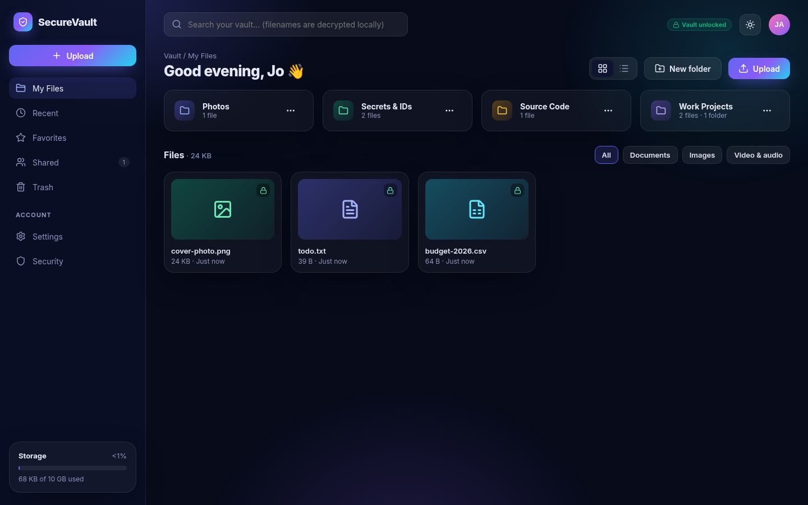
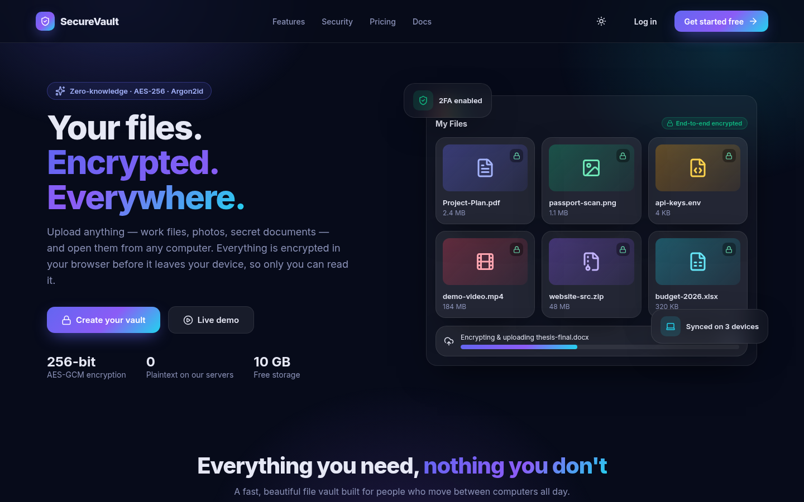
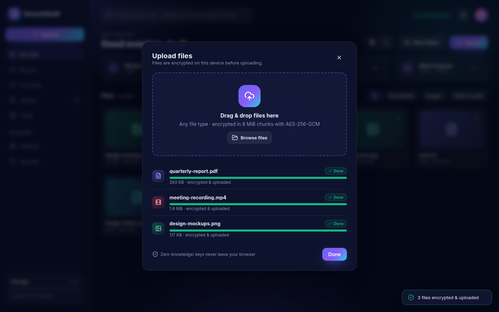
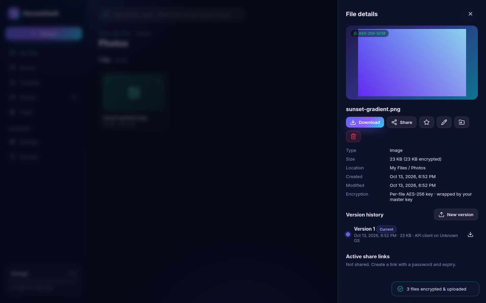
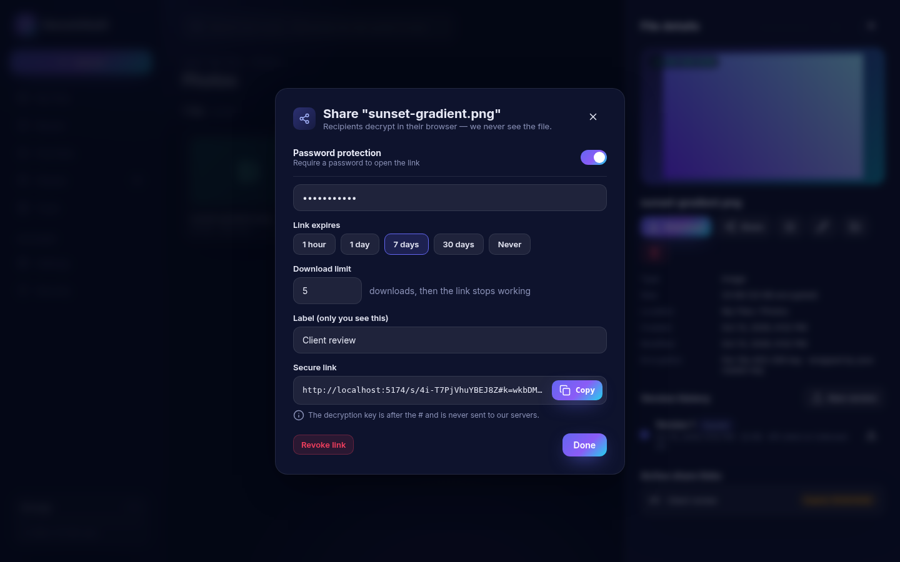
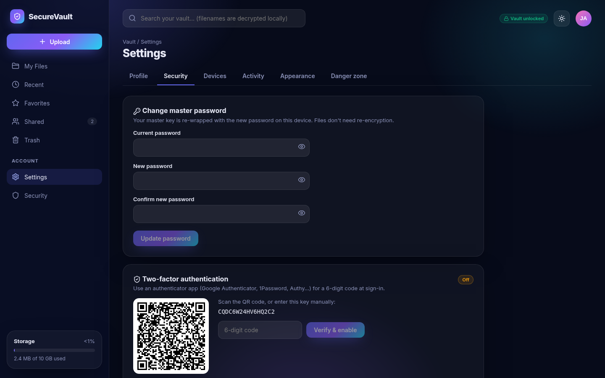
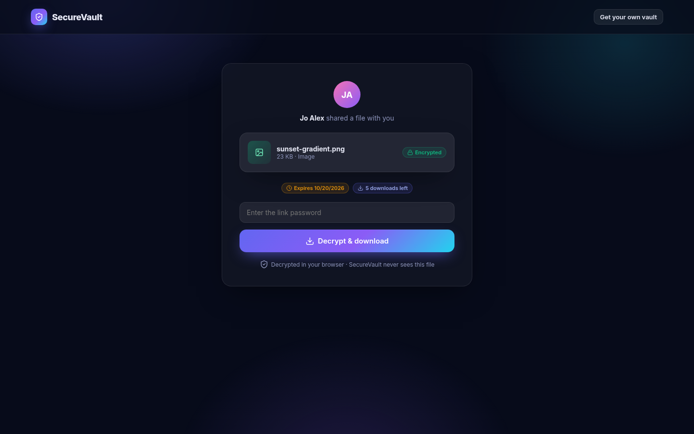
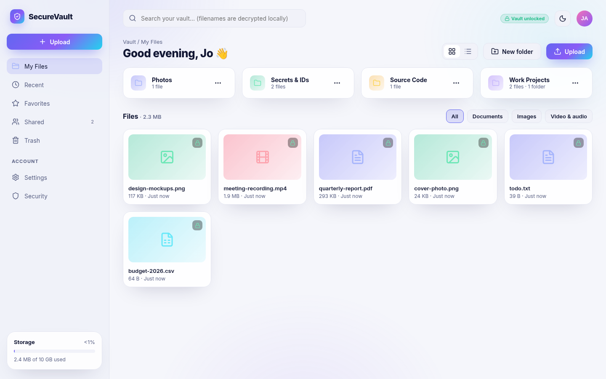
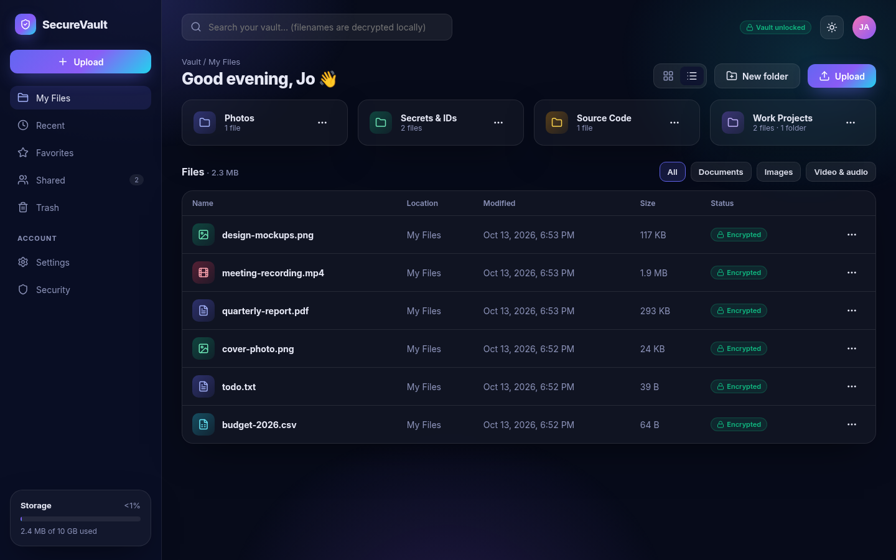

# 🔐 SecureVault

**Zero-knowledge encrypted file vault — upload any file, open it from any computer, and nobody but you can read it.**

SecureVault is a full-stack **MERN** app (MongoDB + Express + React + Node) with **Prisma** as the ORM.
Every file *and* filename is encrypted **in your browser** with AES-256-GCM before upload. The server only
ever stores ciphertext, so even a full server/database breach doesn't expose your files.



## ✨ Features

| Area | What you get |
|---|---|
| **Zero-knowledge crypto** | Argon2id key derivation (PBKDF2 fallback), separate auth key, wrapped master key, per-file AES-256-GCM keys, encrypted filenames, 8 MiB chunked encryption with chunk-order protection, recovery key |
| **Accounts** | Sign-up with strength meter, recovery-key screen, login, TOTP 2FA (QR + backup codes), unlock-after-reload, password change (re-wraps keys), account recovery, delete account |
| **Sessions** | 15-min JWT access tokens (memory only) + rotating httpOnly SameSite=Strict refresh cookie with reuse detection, device list + remote sign-out, login alerts in activity log |
| **File manager** | Folders (create / rename / move / nested / trash), drag & drop upload anywhere, multi-file upload with per-file progress, grid & list views, client-side search over decrypted names, favorites, recent, trash with restore / delete forever / empty, rename, move (dialog or drag onto folder) |
| **Versions** | Upload a new version, list, download any version, restore |
| **Previews** | Decrypted in the browser: images, PDF, video, audio, text/code |
| **Sharing** | Links with the key in the URL `#fragment`, optional password (Argon2id), expiry, download limit, revoke, "Shared" view; public page decrypts in the recipient's browser |
| **Storage** | Pluggable: local disk (default) or S3 / Cloudflare R2 / Backblaze via pre-signed URLs; per-user quota + usage meter |
| **Security** | helmet + CSP, strict CORS, rate limiting, account lockout, NoSQL-injection sanitizer, zod validation everywhere, CSRF guard on cookie routes, body-size limits, ownership checks on every route, pino logging, no secrets in repo |
| **UI** | Dark navy/indigo glass design with gradient accents & lock badges, light/dark toggle, responsive (mobile sidebar), Framer Motion animations |

## 📸 Screenshots

| | |
|---|---|
|  |  |
|  |  |
|  |  |
|  |  |

## 🚀 Quick start

Requirements: **Node.js 20+**. No database needed for local dev (an in-memory MongoDB replica set starts automatically).

```bash
# 1. API (port 5100) – seeds the demo account on start
cd server
npm install            # also runs `prisma generate`
cp .env.example .env   # optional; defaults work for local dev
SEED_DEMO=1 npm start

# 2. Web app (port 5174) – in a second terminal
cd client
npm install
npm run dev
```

Open **http://localhost:5174** and click **Live demo**, or log in with:

- **Email:** `demo@securevault.app`
- **Password:** `Demo@12345`

> ⚠️ Without `DATABASE_URL` the data lives in memory and disappears when the API stops. Point `DATABASE_URL` at MongoDB Atlas to keep it (see [docs/DEPLOYMENT.md](docs/DEPLOYMENT.md)).

## 🧪 Tests

```bash
cd server && npm test          # Jest + Supertest: 69 tests (auth, 2FA, files, folders, versions, trash, shares, quotas, authorization)
cd client && npm run e2e       # Playwright: real browser register → upload → download/decrypt → share → public download
cd client && npx vite build    # production build
```

## 📚 Documentation

| Doc | Contents |
|---|---|
| [ARCHITECTURE.md](docs/ARCHITECTURE.md) | System design, data flows, folder structure |
| [SECURITY.md](docs/SECURITY.md) | Threat model, crypto details, OWASP Top 10 mapping |
| [API.md](docs/API.md) | Every endpoint with request/response |
| [DATABASE.md](docs/DATABASE.md) | Prisma schema and model notes |
| [COMPONENTS.md](docs/COMPONENTS.md) | Every React component, hook and store |
| [DEVELOPMENT.md](docs/DEVELOPMENT.md) | Setup, scripts, Prisma, testing, linting |
| [DEPLOYMENT.md](docs/DEPLOYMENT.md) | Atlas, R2/S3, Render/Railway, Vercel |
| [USER-GUIDE.md](docs/USER-GUIDE.md) | How to use SecureVault |
| [SecureVault-Documentation.pdf](docs/SecureVault-Documentation.pdf) | All of the above in one PDF |

## 🗂 Project structure

```
securevault/
├── client/                 React 18 + Vite + Tailwind + TanStack Query + Zustand
│   ├── src/crypto/         core.js (primitives) · vault.js (upload/download/share flows)
│   ├── src/api/            fetch wrapper with token refresh · account flows
│   ├── src/stores/         auth (keys in memory) · ui · theme
│   ├── src/hooks/          useVault · useUploader · useFileActions · useDecryptedFile
│   ├── src/components/     AppShell, Sidebar, FileCard, DetailsPanel, ShareDialog, …
│   ├── src/pages/          Landing, Signup, Login, Files, Shared, Settings, PublicShare, …
│   └── tests/e2e/          e2e.mjs · screenshots.mjs
├── server/                 Express (ESM) + Prisma (MongoDB)
│   ├── prisma/schema.prisma
│   ├── src/routes/         auth · account · files · shares
│   ├── src/middleware/     auth · validate · security · error
│   ├── src/services/       storage (local / s3) · tokens · vault · activity
│   ├── src/seed/           demo account seeder
│   └── tests/              Jest + Supertest
└── docs/                   documentation + screenshots + PDF
```

## License

MIT — built by Jo Alex as a learning project. Review [SECURITY.md](docs/SECURITY.md) before storing truly sensitive data.
